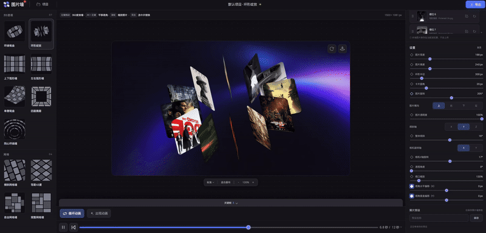
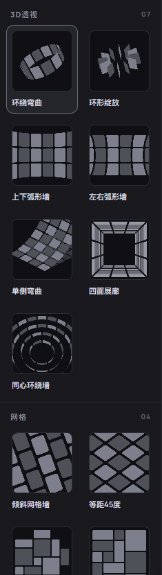
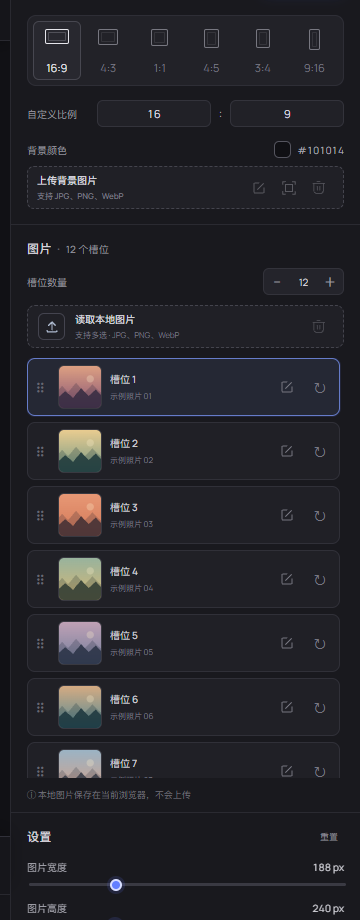
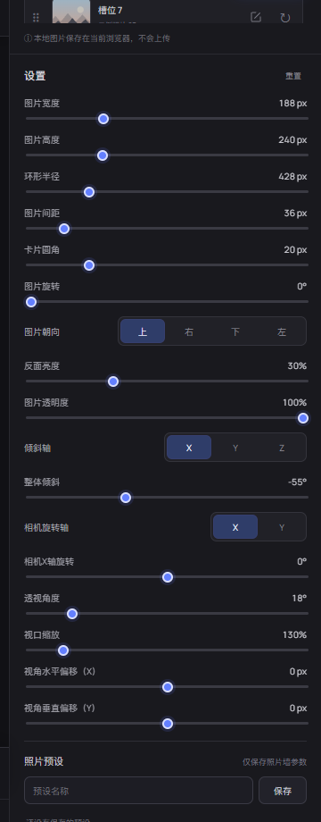
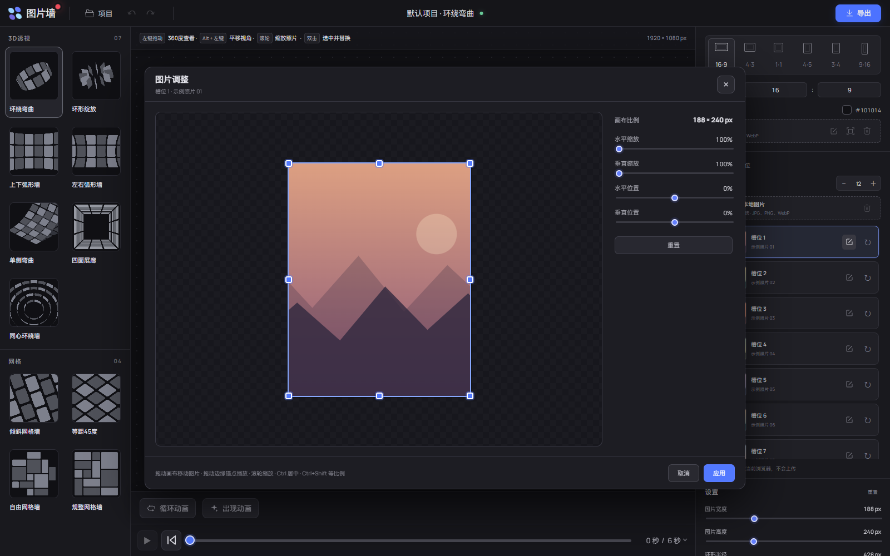
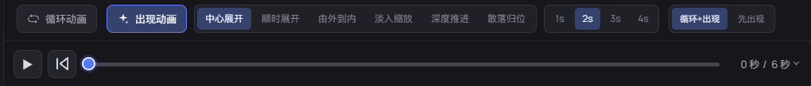
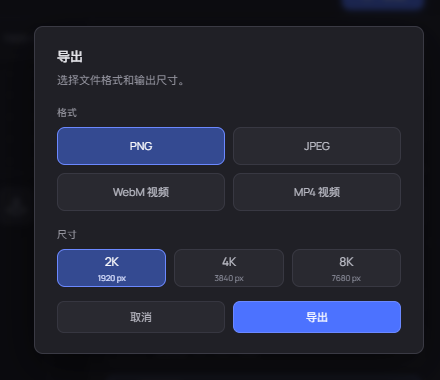

# 图片墙工作室

一个在浏览器里完成照片墙排版、视角调整、动画预览和视频导出的 3D 编辑器。拖入图片即可开始，布局、参数、项目和图片都保存在当前浏览器中。

[在线体验](https://photo-wall-editor.pages.dev) · [作者主页](https://workbench-sync.top/) · [GitHub 仓库](https://github.com/bangbang-PPT/bangbang-photo-wall-editor)



## 先看懂界面

编辑器按“选择布局 → 调整画布 → 编辑图片 → 制作动画 → 导出”的顺序组织。左侧负责构图，中间负责观察，右侧负责参数和图片，底部负责时间轴。

<table>
  <tr>
    <td width="50%" valign="top"><p align="center"></p><strong>布局预设</strong><br>环绕、弧形、网格、展廊等布局一键切换，适合快速探索构图。</td>
    <td width="50%" valign="top"><p align="center"></p><strong>画布与图片槽位</strong><br>选择画幅、设置背景、增减槽位、拖动排序，图片始终留在当前浏览器。</td>
  </tr>
  <tr>
    <td width="50%" valign="top"><p align="center"></p><strong>参数面板</strong><br>尺寸、间距、圆角、旋转、透视、视口缩放和相机偏移都可以单独调节。</td>
    <td width="50%" valign="top"><p align="center"></p><strong>图片调整</strong><br>在独立画布中拖动、缩放和定位单张图片，边界锚点会实时显示画布范围。</td>
  </tr>
  <tr>
    <td colspan="2" valign="top"><p align="center"></p><strong>动画时间轴</strong><br>出现动画、循环动画、关键帧和播放控制集中在底部，时间轴时长直接决定导出时长。</td>
  </tr>
  <tr>
    <td colspan="2" valign="top"><p align="center"></p><strong>导出</strong><br>支持 PNG、JPEG、WebM 和 MP4，可选择 2K、4K 或 8K 输出尺寸。</td>
  </tr>
</table>

## 主要功能

| 区域 | 适合做什么 |
| --- | --- |
| 左侧布局 | 在 3D 环绕、弧形墙、四面展廊和网格墙之间切换，快速找到照片墙结构。 |
| 中央画布 | 左键拖动观察、Alt + 左键平移、滚轮缩放、双击选中图片，实时查看最终构图。 |
| 右侧检查器 | 设置画幅和背景，管理图片槽位，编辑单图裁切，并调节布局与相机参数。 |
| 底部时间轴 | 选择出现方式、循环方式和时长，添加或拖动关键帧，播放检查动画节奏。 |
| 导出面板 | 选择图片或视频格式与输出尺寸，导出当前时间轴范围的高清结果。 |

## 三步开始

1. 点击右侧“读取本地图片”，或直接使用内置示例图。
2. 在左侧选择布局，在中央画布观察效果；需要精调时使用右侧参数和图片编辑按钮。
3. 在底部设置动画和时间轴，再点击右上角“导出”。

项目、图片顺序、槽位数量、单图调整、布局参数和动画设置会自动保存。用户图片只写入浏览器本地 IndexedDB，不会上传到服务器。

## 常用操作

| 操作 | 作用 |
| --- | --- |
| 左键拖动画布 | 旋转观察照片墙 |
| Alt + 左键 / 中键拖动 | 平移视角 |
| 滚轮 | 缩放画布；鼠标停在已选数字框上时微调参数 |
| 双击图片 | 选中并替换图片 |
| 拖动槽位 | 交换照片顺序 |
| Ctrl 拖动图片锚点 | 以中心为基准缩放 |
| Ctrl + Shift 拖动图片锚点 | 等比例缩放 |
| Enter / Esc | 应用图片调整并关闭弹窗 |

## 快速运行

```bash
pnpm install
pnpm dev
```

打开终端显示的本地地址即可开始编辑。

## 当前实现

- 同心环绕墙：默认 4 圈、54 个槽位，从内到外为 7 / 11 / 16 / 20 张。内圈半径 203 px、外圈半径 575 px、圈间距 124 px。各圈卡片统一为 188 × 120 px、圆角 15 px。按周长分配现有槽位，内外圈半径独立控制，中间圈均匀分布；允许密集叠放，不再自动撑大半径。圈间距与外圈半径联动，圆周图片间距由半径、卡片尺寸和数量决定。支持交替整圈错位（默认 0%），反面亮度控制向外的一侧。修改半径保持当前取景，点击适合画布重新取景。保留上传、裁切、参数保存与透明 PNG 导出，修改布局和重置参数都保留图片及槽位总数，最多 96 个槽位。
- 四面展廊：默认 60 个槽位，5 圈 × 每圈 12 张（每面 3 张），默认相机 X 轴旋转 0°、透视角度 62°、视口缩放 140%。四面墙共用一条首尾相接的图片带；竖向错位让第 2、4 圈沿整圈移动，最大半个槽位，第 1、3、5 圈保持对齐。横向错位让沿整圈排列的相邻列交替沿纵深移动。跨过墙角的槽位会连同原图折到相邻墙面，图片、裁切和圆角在接缝处连续，间距按展开后的图片带统一计算。
- 四面展廊最多支持 96 个槽位；增加槽位时保持每圈列数为 4 的倍数，确保四面墙平均分配，最多可形成 8 圈 × 12 张。除同心环绕墙外，其他图片墙仍沿用 72 个槽位上限。
- 四面展廊的横向和竖向错位默认均为 0%。
- 同心环绕墙默认图片朝上、图片旋转 0°、反面亮度及图片透明度 100%，整体倾斜 X / Y / Z 均为 0°；相机 X 轴旋转 −30°、透视角度 47°、视口缩放 250%、水平偏移 0 px、垂直偏移 160 px。重置参数使用相同默认值。
- 同心环绕墙支持层级高度差（Z）：从内到外每圈沿自身 Z 轴递增同一高度差，第一圈保持原位。范围 −600～600 px、默认 66 px，整圈槽位和图片一起移动；支持保存、刷新、重置及导出。
- 错位方向的横向和竖向分别保存各自的错位程度；切换方向只切换当前滑块数值，不会覆盖另一方向的设置。
- 规整网格墙：整体宽高比随画布比例实时改变，用统一模块拼满矩形。卡片只占 1×1、2×1、1×2 或 2×2 格，双格尺寸等于两张单格卡片加一个间距，避免近似尺寸造成零碎错位。
- 自由网格：同样使用整格拼接，在上下两端和左右边缘留出不同深度的整格空白，形成向背景敞开的错落轮廓；中部保持连接，避免孤立卡片。边缘起伏控制退让深度。横向和竖向模式会改变布局的展开方向。
- 自动排列随机合并相邻小格，筛选横竖混排和跨格接缝，减少贯穿整面墙的分隔线。相同跨度的卡片尺寸完全一致；调节间距保留整格结构。
- 两种平面网格墙自动按画布尺寸和照片数量确定卡片尺寸，不再提供基础尺寸、错位程度和分组数量。统一间距以画布设计像素计算；调大间距会在固定外框内缩小卡片，上限随画布尺寸和格数自动更新，并保留足够的卡片宽高。换排列、改变数量或切换画布后，超出新上限的间距自动收敛。100% 适合画布时与画布像素对应，缩放视角会同步缩放间距。 卡片圆角默认 15px。
- 两种新网格墙固定正面正交视角，关闭倾斜、透视和 360° 旋转；左键拖动平移，滚轮缩放，保留「适合画布」和单图裁切调整。恢复旧预设时也会清除旧角度。
- 修复启动时恢复较少槽位后残留白色卡片的问题：项目图片恢复完成后才创建布局，贴图加载完成前隐藏卡片，避免临时槽位对象留在场景中。

- 一个环形透视照片墙效果，以及一个可调弯曲程度的错位弧形照片墙效果
- 12 张内置示例图，可本地多选或读取文件夹替换
- 槽位数量可在 3–72 之间增减；新增槽位会自动填入示例图、显示在右侧并加入环形预览
- 拖动右侧槽位可交换照片顺序
- 支持常用画幅、自定义画布尺寸和背景色
- 图片竖立在圆周上，卡片正面沿半径朝外，整圈以 Z 轴为轴线
- 默认模型方位为 0°，没有隐藏的水平旋转偏移；整体倾斜（X 轴）作为模型参数显示，范围 -180°–180°，默认 -55°；相机俯仰（X 轴）默认 0°，范围 -180°–180°；环形照片墙相机方位默认 50°并支持 360°连续环绕
- 环形照片墙默认使用半径 420 px、图片间距 36 px、透视角度 18°和视口缩放 130%，方便打开后直接得到预览构图
- 环形和弧形照片墙使用独立参数配置；切换效果会加载各自的布局、相机和显示参数，互不覆盖，切回时保留各自最近一次调整
- 支持调整独立的环形半径、图片间距、卡片圆角、图片旋转相位、反面亮度、整体倾斜（X 轴）、相机俯仰（X 轴）、相机方位（Y 轴）与透视角度
- 弧形错位照片墙支持独立调整行数、每行数量、列间距、行间距和整体弯曲；默认 3 行 × 每行 10 张、弯曲 -120°，相邻行自动错开半张卡片，弯曲值为 0° 时保持平面，正值向前凸出、负值向后凹入
- 角度参数支持右键快捷切换：在 0° 和 90° 之间来回切换，环形和弧形模式通用
- 点击右侧参数数字后可用鼠标滚轮按该参数步长微调：行数和数量每次 ±1，角度每次 ±10°，未点击时不影响面板滚动
- 其他照片墙画布支持 C4D 风格观察：普通左键水平拖动调整相机方位，垂直拖动调整相机俯仰，方位支持 360°连续环绕，俯仰使用四元数轨道控制，经过极点时保持姿态连续；整体倾斜由独立滑块控制；按住 Alt + 左键拖动平移视角，也支持中键平移；可以完整观察 360°
- 视角水平偏移（X）和视角垂直偏移（Y）提供平移后的数值控制，单位为画布设计像素；与相机方位、俯仰和透视独立，并随模式预设保存
- 环形照片墙默认卡片尺寸为 188 × 240 设计像素；两种新网格墙使用混合比例。照片居中等比填充，超出部分裁切，不拉伸
- 图片材质使用无光照、无色调映射的纯色显示，保留原图 sRGB 颜色，不额外加曝光、发光或朝向变暗
- 环形半径和图片间距独立控制；卡片保持比例等比缩放，首尾与相邻图片的空间间距一致
- 图片旋转只改变图片槽位在环上的相位，不改变墙体和相机角度
- 点击任意图片槽位右侧的调整按钮，会在该槽位上方打开「图片调整」弹窗，可单独修改图片缩放、水平位置和垂直位置；弹窗关闭后不占用列表空间，调整只作用于该槽位
- 圆角支持 0–94 设计像素，实时预览与 PNG 导出使用同一圆角效果
- 调节半径时镜头保持固定；「适合画布」会重新容纳整圈
- 视口缩放支持底部按钮、右侧滑块和画布滚轮，范围为 40%–400%，调整的是照片在画布中的显示大小，不影响导出像素尺寸；「适合画布」会同时恢复 100% 缩放并将视角居中
- 透视角度单独控制相机视场角；角度越大，近处和远处卡片的大小差异越明显，滚轮缩放不会改变透视关系
- 在浏览器本地导出透明 PNG，不上传用户图片；预览背景色不会写入导出的文件
- 顶部「项目」用于管理本地图片内容：可新建、切换、重命名和删除项目，项目会自动保存槽位图片、顺序、数量、单图调整以及完整的照片墙参数；每个项目的画布、环形/弧形设置、相机视角和背景相互独立，并显示最近一次调整后的照片墙缩略图；删除项目时会同步清理其 IndexedDB 图片缓存；环形与弧形效果都可以在每个项目中使用。上传图片会存入浏览器 IndexedDB，不上传服务器
- 右侧「照片预设」只保存当前照片墙的布局、相机、画布、背景和显示参数，不包含图片；切换预设不会替换当前项目的图片，预设最多保留 20 条

未保存到预设的临时图片仍使用当前会话对象 URL；保存到预设的本地图片会从浏览器 IndexedDB 恢复，不依赖原始文件路径。

## 验证

`node --test tests/*.test.mjs` 检查相机和网格几何，包括全部支持的数量、共享接缝间距、比例、轮廓及随机种子。

启动开发服务器后运行 `node tests/browser-regression.cjs` 检查白图回归、模式切换、固定视角、平移缩放、项目恢复和 PNG 导出。该脚本需要可用的 Playwright；也可通过 `PLAYWRIGHT_MODULE` 指定已有 Playwright 包的绝对路径。浏览器测试使用独立的临时会话，不修改当前编辑器的项目。

`node tests/room-browser.cjs` 单独验证四面展廊的交替整圈错位、跨角折图、图片顺序、参数恢复及透明 PNG 导出。

`node tests/concentric-browser.cjs` 验证同心环绕墙的统一卡片尺寸、整圈错位、上传图片保存、模式切换、刷新与重置，以及透明 PNG 导出。
